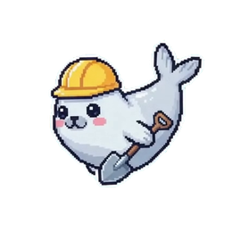

# Seal Pet

[ภาษาไทย: วิธีติดตั้งและใช้งาน](README.th.md)

A small seal that floats on the Windows desktop and acts out what Claude Code is doing:
claps while loading, swims in a hard hat while working, waves from an ice floe while asking,
and naps when the turn is done or idle.

- Borderless, transparent around the seal, always on top, no taskbar button.
- Pointing at the seal shows the system's hand pointer.
- **Click** the seal: a menu of three round buttons pops up above it
  1. arrows (**Resize**): resize mode. Turn the mouse wheel over the seal or drag its corner
     handle; the seal fits anywhere from a 32 x 32 to a 512 x 512 px box. Click the seal when done.
  2. gear (**Settings**): unfolds a second row with two buttons
     - speech bubble (**Show status**): show or hide a status bubble ("Working…", "Need your input!", ...)
     - pencil (**Edit status**): opens the status editor (see below).
  3. cross (**Close**): quit
- **Press and hold** (or press and move): drag the seal anywhere.
- Position, size and the status bubble are remembered in `%LOCALAPPDATA%\seal-pet\placement`.

### The status bubble

A thought bubble drawn in the seal's pixel-art style (dark outline, white sticker edge,
icy shading) with a little trail of round bubbles pointing at the seal. It pops out of
the seal one bubble at a time, floats gently while it is up, bounces when the state
changes, and fades away when hidden. While Claude is thinking, working or asking, a soft
ring ripples out of the colored dot.

### The status editor

- One text box per state. Type `\n` where the bubble should start a new line.
- Click a state's name (or its text box) to select it: the seal plays that state's
  animation and the bubble previews its words, so you can see each state as you edit it.
- **Text color** sets the selected state's color, so every state can have its own
  (eight swatches, or **+** for any color).
- **Bubble**: **Show status** turns the bubble on or off; **Auto hide** hides it again
  1–20 seconds after each state change.
- **Save** (or Enter) keeps the changes in `%LOCALAPPDATA%\seal-pet\status.txt`;
  **Cancel**, × or Escape drops them; **Reset** restores the default words and colors.

## How it knows the state

Claude Code hooks in `~/.claude/settings.json` write one word to
`%LOCALAPPDATA%\seal-pet\state` (`loading`, `working`, `asking`, `completed`,
or `idle`).
Seal Pet checks that file every 400 ms and switches animation when it changes.

The exe writes that file itself: `seal-pet.exe --set working` writes the word and exits
at once (the running seal is left alone). To set the hooks up, build the exe, then run:

```powershell
powershell -ExecutionPolicy Bypass -File tools\install-hooks.ps1
```

It adds these hooks, each a plain `seal-pet.exe --set <state>` command line that every
Claude Code version runs, and keeps every other hook you have (it backs `settings.json` up first; `-Remove` takes them out again,
`-Exe <path>` points them at another copy of the exe):

| Claude Code event | State |
|---|---|
| `SessionStart`, `SessionEnd` | `idle` |
| `UserPromptSubmit` | `loading` |
| `PreToolUse`, `PostToolUse` | `working` |
| `PermissionRequest`, `Notification` (permission, idle, MCP prompts) | `asking` |
| `Stop` | `completed` |

Restart Claude Code afterwards so it loads them (a session started before the hooks
were installed does not run them). Hooks only fire for Claude Code running on this
computer. The Claude desktop app works too: it is a packaged (MSIX) app, so Windows
redirects the state file its hooks write into
`%LOCALAPPDATA%\Packages\<app>\LocalCache\Local\seal-pet\state`; Seal Pet reads those
copies as well and follows whichever was written last. The hooks run the exe at the path you installed, and Windows locks a
running exe, so close the seal before rebuilding it.

## System requirements

- 64-bit Windows 10 or later.
- No additional runtime is required to run the downloaded release executable.
- Claude Code is optional; it is only needed if you want Seal Pet to display
  Claude Code's status automatically.
- Building from source requires the stable Rust toolchain.

## Build and run

```bash
cargo build --release
```

```bash
target/release/seal-pet.exe
```

Only one seal runs at a time. To start it with Windows, put a shortcut to
`seal-pet.exe` in `shell:startup`.

## Install a release

Download `seal-pet.exe` from the [GitHub Releases](https://github.com/thanachaiakt/ai-mascot-status/releases)
page and save it where you want to keep the app. Run the executable to start
Seal Pet. To launch it automatically at sign-in, put a shortcut to the
executable in `shell:startup`. Releases provide the standalone executable; no
installer is included.

## The art

Each state image is an animated frame strip. Seal Pet plays the matching strip
for the current state. The previews below show the first frame; click a preview
to open its full animation strip; `assets/gif/` has each state as a transparent GIF.

| State | Image | What the seal does |
|---|---|---|
| `loading` | [](assets/loading.png) | Claps happily and flaps its flippers while thinking. |
| `working` | [](assets/working.png) | Swims and spins in a hard hat, shovel in hand, while working. Shown 1.15× larger, since the swimmer is drawn smaller than the other seals; the window reaches past the seal's box so the whole swimmer stays in view at the edges and mid-spin. |
| `asking` | [](assets/asking.png) | Sits on an ice floe and waves to ask for input. |
| `completed` | [](assets/completed.png) | Naps under floating zZ after the turn is done. |
| `idle` | [](assets/completed.png) | Uses the same napping animation while idle. |

An unknown or missing state also uses the napping animation. The strips are
260 x 260 px (1:1) per frame, cut from the 2 x 2 clip `art/states.mp4` (not kept in the repository; one
state per quarter) by `tools/video_states.py`: it cuts each seal out of the blue
grid backdrop, trims it to a seamless loop, crops it square, and writes the strip,
its preview and a 300 x 300 GIF (`assets/gif/<state>.gif`). Asking loops only the
part where the seal waves its right flipper; the clip's left-flipper wave draws a
third flipper. The swimmer's tail, lost for two frames mid-spin, is put back
from a neighbouring frame. The pet keeps the strips as palette indices (1 byte a
pixel) and scales the current frame to the seal's size as it draws it, keeping
the frame's aspect.

- `assets/menu.png`: the menu buttons, drawn by `tools/render_ui.py`.

The scripts need Pillow; `video_states.py` also needs NumPy, SciPy and `ffmpeg`
on `PATH`. Re-run them after changing the art, then rebuild.

For the full behavior, input format, and persistence contract, see
[SPEC.md](SPEC.md).
