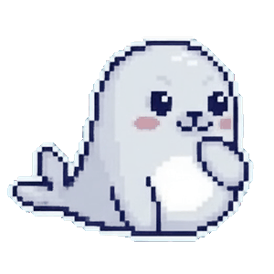
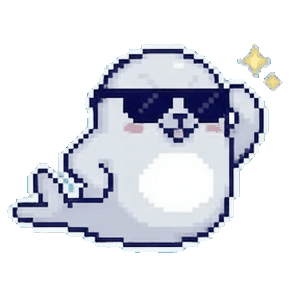
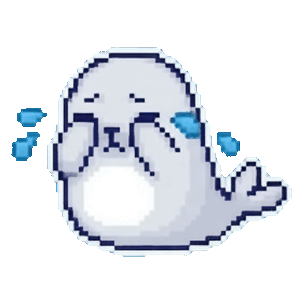
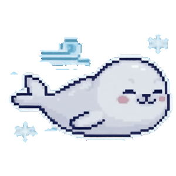
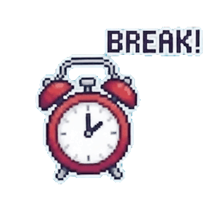
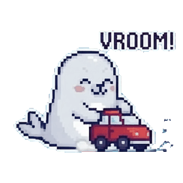
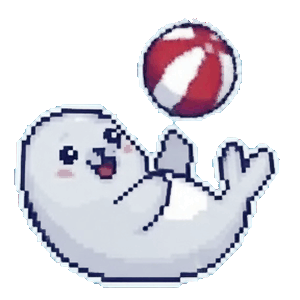
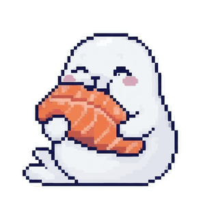

# ai-mascot-hook (ภาษาไทย)

[English](README.md)

แมวน้ำตัวเล็กที่ลอยอยู่บนหน้าจอ Windows หรือ macOS และแสดงท่าทางตามสิ่งที่ Claude Code กำลังทำ
ตบมือแล้วนั่งคิดตอนคิด ว่ายน้ำใส่หมวกนิรภัยตอนทำงาน โบกมือบนก้อนน้ำแข็งตอนรอคำตอบ
ใส่แว่นกันแดดเท่ๆ ตอนเสร็จงาน ร้องไห้ตอนเกิด error และนอนหลับตอนว่าง ตื่นมาเล่นทุก 1 นาที (ปรับได้)
ให้อาหาร (แซลมอน) ได้จากเมนู และตั้งเวลาพักให้นาฬิกาปลุกดังพร้อมข้อความของคุณได้ พร้อมกล่องข้อความบอกสถานะแบบ pixel art เข้าชุดกับตัวแมวน้ำ

<p align="center">
  
  
  
  <br>
  
  
  
  <br>
  
  
  
  
</p>

## สารบัญ

- [ดาวน์โหลด](#ดาวน์โหลด)
- [โปรแกรมทำงานอย่างไร](#โปรแกรมทำงานอย่างไร)
- [ติดตั้งบน Windows](#ติดตั้งบน-windows)
- [ติดตั้งบน macOS](#ติดตั้งบน-macos)
- [วิธีใช้งาน](#วิธีใช้งาน)
- [การเก็บ setting](#การเก็บ-setting)
- [ถอนการติดตั้ง](#ถอนการติดตั้ง)
- [แก้ปัญหา](#แก้ปัญหา)
- [Build เอง](#build-เอง)
- [ภาพและแอนิเมชัน](#ภาพและแอนิเมชัน)

## ดาวน์โหลด

โหลดตัวติดตั้งจากหน้า [release ล่าสุด](https://github.com/thanachaiakt/ai-mascot-hook/releases/latest)
เลื่อนลงไปที่หัวข้อ **Assets** แล้วเลือกไฟล์ให้ตรงกับระบบของคุณ

| ระบบ | ไฟล์ใน Assets | ขั้นต่อไป |
| --- | --- | --- |
| Windows 10 ขึ้นไป (64 บิต) | `ai-mascot-hook-<version>-setup.exe` | [รันไฟล์](#ตัวติดตั้งบน-windows) |
| macOS 11 ขึ้นไป (ชิป Apple หรือ Intel) | `ai-mascot-hook-<version>-macos.tar.gz` | [รัน `install.sh`](#ตัวติดตั้งบน-macos) |

อยาก build เอง ดู [Windows ติดตั้งเอง](#windows-ติดตั้งเอง),
[macOS ติดตั้งเอง](#macos-ติดตั้งเอง) หรือ [Build เอง](#build-เอง)

## โปรแกรมทำงานอย่างไร

มีสองส่วนที่ทำงานร่วมกัน โดยไม่ได้คุยกันตรงๆ แต่ใช้ไฟล์เล็กๆ ไฟล์เดียวเป็นตัวกลาง
เหมือนการฝากโน้ตไว้บนโต๊ะ

```text
Claude Code ──(เรียก hook)──▶ ai-mascot-hook --set working ──▶ เขียนคำว่า "working"
                                                               ลงในไฟล์ `state`
                                                                      │
แมวน้ำบนหน้าจอ ◀──(อ่านไฟล์ทุก 0.4 วินาที)────────────────────────────┘
      └─ เห็นคำใหม่ แล้วเล่นท่าทางนั้น พร้อมแสดงกล่องข้อความ
```

1. **Hook (ผู้ส่งโน้ต)** Claude Code สั่งให้รันคำสั่งได้เมื่อมีเหตุการณ์เกิดขึ้น
   เช่น คุณส่งข้อความ, Claude ใช้ tool, ขออนุญาต, หรือตอบเสร็จ
   ตอนติดตั้ง โปรแกรมจะเพิ่มคำสั่งให้แต่ละเหตุการณ์ลงใน `~/.claude/settings.json`
   คำสั่งนั้นคือ `ai-mascot-hook --set <สถานะ>` เขียนคำบอกสถานะหนึ่งคำลงไฟล์ `state` แล้วจบทันที
2. **แมวน้ำ (ผู้อ่านโน้ต)** โปรแกรมเดียวกัน ถ้าเปิดโดยไม่ใส่อะไรต่อท้าย จะเป็นแมวน้ำบนหน้าจอ
   มันเปิดไฟล์ `state` ดูทุก 400 มิลลิวินาที เจอคำใหม่ก็เปลี่ยนท่าตามนั้น
   เปิดได้ทีละตัวเท่านั้น

| เหตุการณ์ของ Claude Code | สถานะ | แมวน้ำทำอะไร |
|---|---|---|
| เริ่ม/จบ session (`SessionStart`, `SessionEnd`) | `idle` | นอนหลับ ตื่นมาเล่นทุก 1 นาที (ปรับได้) |
| ส่งข้อความ (`UserPromptSubmit`) | `loading` | ตบมือ แล้วนั่งคิด |
| ก่อน/หลังใช้ tool (`PreToolUse`, `PostToolUse`) | `working` | ว่ายน้ำใส่หมวกนิรภัย |
| ขออนุญาต หรือรอคำตอบ (`PermissionRequest`, `Notification`) | `asking` | โบกมือเรียกคุณ |
| ตอบเสร็จ (`Stop`) | `completed` | ใส่แว่นกันแดดเท่ๆ เสร็จแล้ว ผ่านไป 10 วินาทีกลับไปนอนหลับ |
| ตอบไม่จบเพราะ API error (`StopFailure`) | `error` | ร้องไห้ |

Hook ทำงานเฉพาะ Claude Code ที่รันบนเครื่องนี้ และโปรแกรมไม่ส่งข้อมูลอะไรออกทางเน็ตเลย

### AI ตัวอื่น

AI ตัวอื่นใช้คำสั่งเดียวกัน แต่ผูกกับ event ของตัวเอง บางตัวไม่มี event ครบทุกสถานะ
ช่องที่เป็น `–` หมายถึง AI ตัวนั้นไม่มีทางทำให้แมวน้ำแสดงสถานะนั้น

| AI | `idle` | `loading` | `working` | `asking` | `completed` | `error` |
|---|---|---|---|---|---|---|
| Claude Code, Qwen Code | `SessionStart`, `SessionEnd` | `UserPromptSubmit` | `PreToolUse`, `PostToolUse` | `PermissionRequest`, `Notification` | `Stop` | `StopFailure` |
| Cursor | `sessionStart`, `sessionEnd` | `beforeSubmitPrompt` | `preToolUse`, `postToolUse` | – | `stop` | – |
| GitHub Copilot CLI | `sessionStart`, `sessionEnd` | `userPromptSubmitted` | `preToolUse`, `postToolUse` | `notification` | `agentStop` | `errorOccurred` |
| Gemini CLI | `SessionStart`, `SessionEnd` | `BeforeAgent` | `BeforeTool`, `AfterTool` | `Notification` | `AfterAgent` | – |
| OpenAI Codex | `SessionStart`, `SessionEnd` | `UserPromptSubmit` | `PreToolUse`, `PostToolUse` | `PermissionRequest` | `Stop` | – |
| Windsurf | – | `pre_user_prompt` | `pre_read_code`, `pre_write_code`, `pre_run_command`, `pre_mcp_tool_use` | – | `post_cascade_response` | – |
| Kiro | `SessionStart` | `UserPromptSubmit` | `PreToolUse`, `PostToolUse` | – | `Stop` | – |

- **Qwen Code** ใช้ hook ชุดเดียวกับ Claude Code ทุกอย่าง `StopFailure` ของ Qwen
  ยังยิงตอนระบบตรวจเจอว่าวนลูปแล้วหยุดรอบนั้นด้วย แมวน้ำจึงร้องไห้ในกรณีนั้นเช่นกัน
- **Cursor** แจ้งรอบที่จบเพราะ error หรือถูกหยุดกลางทาง ผ่าน event `stop` ตัวเดียวกัน
  แมวน้ำจึงแสดง `completed` ในกรณีเหล่านั้นด้วย hook `preToolUse` และ `beforeSubmitPrompt`
  ต้องตอบกลับทาง stdout ซึ่ง hook ทำให้แล้ว (`--reply allow`, `--reply continue`)
- **Copilot CLI** เรียก `permissionRequest` ก่อนใช้ tool ทุกครั้ง แม้ตัวที่อนุญาตเองอัตโนมัติ
  สถานะ `asking` จึงรอ `notification` ที่บอกว่ากำลังถามคุณจริงๆ (`permission_prompt` หรือ
  `elicitation_dialog`) ส่วน `errorOccurred` ยิงแม้ error ที่ Copilot แก้เองแล้วทำต่อได้
  hook ถัดไปจะพาแมวน้ำกลับไปทำงานเอง
- **Gemini CLI** ยิง `Notification` ตอนขออนุญาต และนับ timeout ของ hook เป็นมิลลิวินาที
  hook ของ Gemini จึงตั้งไว้ 10000 แทน 10
- **Codex** ต้องได้ JSON จาก hook `Stop` (`--reply empty` พิมพ์ `{}`) และจะให้ตรวจ hook
  ใหม่ครั้งหนึ่งผ่าน `/hooks`
- **Windsurf** (Cascade) ไม่มี event ของ session หลังจบ session แมวน้ำจึงค้างที่สถานะสุดท้าย
  จนกว่าจะส่งข้อความถัดไป
- **Kiro** มี `SessionEnd` เฉพาะใน CLI จึงไม่ได้ใส่ไว้ แมวน้ำจะกลับไป `idle` ตอนเริ่ม session ใหม่

## ติดตั้งบน Windows

ต้องใช้ Windows 10 ขึ้นไปแบบ 64 บิต
Claude Code ไม่บังคับ (ถ้าไม่มี แมวน้ำก็ยังรันได้ และสั่งเองด้วย `--set` ได้)

### ตัวติดตั้งบน Windows

วิธีที่ง่ายสุด ตัวติดตั้งลงให้เฉพาะผู้ใช้คนนี้ (ไม่ต้องใช้สิทธิ์ admin)
ไว้ที่ `%LOCALAPPDATA%\Programs\ai-mascot-hook`

1. **ดาวน์โหลด** เปิดหน้า [release ล่าสุด](https://github.com/thanachaiakt/ai-mascot-hook/releases/latest)
   เลื่อนลงไปที่ **Assets** แล้วโหลด `ai-mascot-hook-<version>-setup.exe`
2. **รันไฟล์** ดับเบิลคลิกไฟล์ที่โหลดมา
   หน้าแรกให้เลือกภาษา อังกฤษหรือไทย แล้วตัวติดตั้งและตัวถอนการติดตั้งจะใช้ภาษานั้น
3. **เลือก AI ที่ใช้** ก่อนจะแตะไฟล์ตั้งค่าใดๆ ตัวติดตั้งจะมีหน้าอธิบายว่าจะเพิ่มอะไรลงไฟล์ไหน
   พร้อมช่องให้ติ๊กของ Claude Code, Cursor, GitHub Copilot CLI, Gemini CLI, OpenAI Codex,
   Qwen Code, Windsurf และ Kiro โดย Claude Code และ AI ที่พบในเครื่องจะถูกติ๊กไว้ให้ก่อน
   ถ้าไม่ต้องการ hook ให้เอาเครื่องหมายถูกออกให้หมด
4. **ให้เปิดเองตอนเข้า Windows (ไม่บังคับ)** ติ๊กตัวเลือกในตัวติดตั้ง
5. **เปิด AI ที่เลือกใหม่** แล้วส่งข้อความหา AI แมวน้ำจะตบมือแล้วนั่งคิด

ถอนการติดตั้งได้จาก **Settings > Apps** ซึ่งจะลบ hook ออกจาก AI ทุกตัว (ไม่ใช่แค่ที่เคยติ๊ก)
และลบค่าที่ตั้งไว้ (`%LOCALAPPDATA%\ai-mascot-hook`: ตำแหน่ง ขนาด ข้อความและสีของฟองสถานะ) ทิ้งให้
ไม่เหลืออะไรไว้ นอกจากไฟล์สำรอง `.bak-<เวลา>` ของไฟล์ที่เคยแก้

ถ้าจะอัปเดต ให้รัน `setup.exe` รุ่นใหม่ทับของเดิมได้เลย (บน Mac รัน `install.sh` ซ้ำ) ตัวติดตั้งจะบอกว่า
อัปเดตจากรุ่นไหน เก็บการตั้งค่าและ hook ไว้ครบ แล้วเปิดแมวน้ำใหม่ให้
ใน Assets มีไฟล์ `.zip` ที่มีแค่ exe สำหรับติดตั้งเองตามขั้นตอนด้านล่างด้วย

### Windows ติดตั้งเอง

1. **Build** ติดตั้ง Rust จาก <https://rustup.rs> (ข้ามได้ถ้าสั่ง `cargo --version` ได้อยู่แล้ว)
   แล้วเปิด PowerShell ในโฟลเดอร์โปรเจกต์ และรัน

   ```powershell
   cargo build --release
   ```

   จากนั้น copy `target\release\ai-mascot-hook.exe` ไปวางในโฟลเดอร์ที่จะเก็บถาวร
   และ **path ต้องไม่มีช่องว่าง** เช่น `C:\Tools\ai-mascot-hook\ai-mascot-hook.exe`
   ไม่ควรวางไว้ใน Downloads เพราะ hook จะเรียกไฟล์จาก path นี้ตลอด ถ้าย้ายทีหลัง hook จะใช้ไม่ได้
2. **เปิดแมวน้ำ** ดับเบิลคลิก `ai-mascot-hook.exe` แมวน้ำจะขึ้นบนหน้าจอ
3. **ติดตั้ง hook** เปิด PowerShell แล้วรัน

   ```powershell
   C:\Tools\ai-mascot-hook\ai-mascot-hook.exe --install-hooks
   ```

   โปรแกรมจะสำรอง `~\.claude\settings.json` ไว้เป็น `settings.json.bak-<เวลา>` ก่อน
   แล้วเพิ่ม hook ตามตารางด้านบน โดยเก็บ hook และค่าอื่นๆ ที่คุณมีอยู่ไว้ครบตามลำดับเดิม
   เพิ่มหรือแทนที่เฉพาะ hook ของ ai-mascot-hook เท่านั้น และบันทึกไฟล์เป็น JSON แบบย่อหน้า
   (ถ้ามี repo อยู่ในเครื่อง ใช้
   `powershell -ExecutionPolicy Bypass -File tools\install-hooks.ps1 -Exe <path>` แทนได้ ผลเหมือนกัน)
4. **เปิด Claude Code ใหม่** ปิดแล้วเปิดใหม่ (หรือเปิด session ใหม่ใน Claude desktop app)
   **session ที่เปิดไว้ก่อนติดตั้ง hook จะไม่เรียก hook** ลองส่งข้อความหา Claude
   แมวน้ำจะตบมือแล้วนั่งคิด (loading) ทันที

   **Agent อื่น** เติม `--agent` ตามด้วย `cursor`, `copilot` (Copilot CLI), `gemini`, `codex`
   (Codex CLI ของ OpenAI; ChatGPT บนเว็บไม่มี hook), `qwen`, `windsurf` หรือ `kiro`
   ต่อท้าย `--install-hooks` เพื่อติดตั้งให้ agent นั้นแทน ใส่หลายตัวคั่นด้วยจุลภาคได้
   (`--agent claude,kiro`) หรือ `--agent all` เพื่อติดตั้งให้ Claude Code และทุก agent ที่พบในเครื่อง
   ถอนด้วย `--remove-hooks --agent <ชื่อ>` Codex จะให้ตรวจ hook ใหม่ครั้งหนึ่งผ่าน `/hooks`
   ส่วน event ไหนตั้งสถานะอะไรของแต่ละ agent ดูได้ที่ [AI ตัวอื่น](#ai-ตัวอื่น)
5. **ให้เปิดเองตอนเข้า Windows (ไม่บังคับ)** กด `Win + R` พิมพ์ `shell:startup` แล้วกด Enter
   จากนั้นสร้าง shortcut ของ `ai-mascot-hook.exe` ไว้ในโฟลเดอร์ที่เปิดขึ้นมา

Claude desktop app ใช้ได้เช่นกัน แต่เป็นแอปแบบ MSIX ซึ่ง Windows จะย้ายไฟล์ที่ hook เขียนไปไว้ใน
`%LOCALAPPDATA%\Packages\<แอป>\LocalCache\Local\ai-mascot-hook\state`
แมวน้ำอ่านไฟล์ตรงนั้นให้ด้วย และตามไฟล์ที่ถูกเขียนล่าสุด

## ติดตั้งบน macOS

ต้องใช้ macOS 11 ขึ้นไป (ชิป Apple หรือ Intel) แมวน้ำไม่มีไอคอนใน Dock

### ตัวติดตั้งบน macOS

วิธีที่ง่ายสุด ไฟล์เดียวใช้ได้ทั้งสองชิป

1. **ดาวน์โหลด** เปิดหน้า [release ล่าสุด](https://github.com/thanachaiakt/ai-mascot-hook/releases/latest)
   เลื่อนลงไปที่ **Assets** แล้วโหลด `ai-mascot-hook-<version>-macos.tar.gz`
2. **แตกไฟล์แล้วรัน** ใน Terminal

   ```bash
   tar -xzf ~/Downloads/ai-mascot-hook-*-macos.tar.gz -C ~/Downloads
   ~/Downloads/ai-mascot-hook-*-macos/install.sh
   ```

   สคริปต์จะถามภาษา (อังกฤษหรือไทย) copy โปรแกรมไปไว้ที่ `~/bin` อธิบายว่าจะเพิ่มอะไรลงไฟล์ไหน
   ถามว่าจะเพิ่ม hook ให้ AI ตัวไหน ตั้งให้แมวน้ำเปิดเองตอน login และเปิดแมวน้ำให้เลย
   ตอบคำถามเหล่านี้ล่วงหน้าได้ด้วย `--lang en|th`, `--agents claude,cursor` (หรือ `all`, `none`) และ `--yes`
3. **เปิด AI ที่เลือกใหม่** แล้วส่งข้อความหา AI แมวน้ำจะตบมือแล้วนั่งคิด

`install.sh --uninstall` ถอนทุกอย่าง: hook ของ AI ทุกตัว รายการเปิดตอน login ตัวโปรแกรม
และค่าที่ตั้งไว้ (`--keep` เก็บค่าที่ตั้งไว้)

### macOS ติดตั้งเอง

build เองครั้งเดียว ประมาณ 1 นาที

1. **ติดตั้ง Rust** จาก <https://rustup.rs> (ข้ามได้ถ้าสั่ง `cargo --version` ได้อยู่แล้ว)
2. **Build** เปิด Terminal ในโฟลเดอร์โปรเจกต์ แล้วรัน

   ```bash
   cargo build --release
   ```

3. **ย้ายโปรแกรมไปไว้ที่ถาวร** เพราะ hook เรียกโปรแกรมตาม path

   ```bash
   mkdir -p ~/bin && cp target/release/ai-mascot-hook ~/bin/
   ```

4. **ติดตั้ง hook** (รันจากไฟล์ที่ copy ไปไว้)

   ```bash
   ~/bin/ai-mascot-hook --install-hooks
   ```

5. **เปิดแมวน้ำ**

   ```bash
   ~/bin/ai-mascot-hook &
   ```

6. **เปิด Claude Code ใหม่** แล้วลองส่งข้อความ แมวน้ำจะตบมือแล้วนั่งคิด
7. **ให้เปิดเองตอน login (ไม่บังคับ)** สร้างไฟล์ `~/Library/LaunchAgents/com.ai-mascot-hook.plist`
   (แก้ path ให้ตรงกับเครื่องคุณ) แล้วรัน
   `launchctl load ~/Library/LaunchAgents/com.ai-mascot-hook.plist`

   ```xml
   <?xml version="1.0" encoding="UTF-8"?>
   <!DOCTYPE plist PUBLIC "-//Apple//DTD PLIST 1.0//EN" "http://www.apple.com/DTDs/PropertyList-1.0.dtd">
   <plist version="1.0">
   <dict>
     <key>Label</key><string>com.ai-mascot-hook</string>
     <key>ProgramArguments</key><array><string>/Users/you/bin/ai-mascot-hook</string></array>
     <key>RunAtLoad</key><true/>
   </dict>
   </plist>
   ```

ส่วนที่เหลือใช้งานเหมือน Windows: การลาก การปรับขนาด เมนูปุ่มกลม หน้าตั้งค่า
และกล่องข้อความ (ปุ่ม **+** ในหน้าตั้งค่าจะเปิดหน้าเลือกสีของ macOS)

## วิธีใช้งาน

- **กดค้างแล้วลาก** (หรือกดแล้วขยับ): ย้ายตำแหน่งแมวน้ำ
- **คลิก** (หรือคลิกขวา): เปิดเมนูปุ่มกลมสี่ปุ่ม (ระหว่างเวลาพัก คลิกซ้ายจะจบเวลาพักแทน)
  1. ปลา (**Feed**): ให้อาหาร แมวน้ำกินแซลมอนพร้อมขอบคุณ (ข้อความตอนให้อาหาร ตั้งได้ในหน้าตั้งค่า)
     แล้วกลับไปทำท่าเดิม
  2. ลูกศร (**Resize**): ปรับขนาด หมุนล้อเมาส์บนตัวแมวน้ำ หรือลากมุมขวาล่าง
     ได้ตั้งแต่ 32 ถึง 512 px คลิกที่แมวน้ำเมื่อเสร็จ
  3. เฟือง (**Settings**): เปิดหน้าตั้งค่า (ดูด้านล่าง) ซึ่งเปิด/ปิดกล่องข้อความสถานะได้ด้วย
  4. กากบาท (**Close**): ปิดโปรแกรม
- กด Esc เพื่อปิดเมนู
- ถึง**เวลาพัก** (ตั้งในหน้าตั้งค่า) แมวน้ำจะเล่นท่านาฬิกาปลุก 1 นาที และกล่องข้อความแสดงข้อความพักของคุณ
  แม้จะปิดกล่องข้อความสถานะไว้ คลิกที่แมวน้ำเพื่อจบเวลาพักก่อนได้
- ตำแหน่ง ขนาด และการเปิด/ปิดกล่องข้อความจะถูกจำไว้ เปิดครั้งหน้าจะอยู่ที่เดิม
- สั่งสถานะเอง (ใช้ทดสอบ หรือเชื่อมกับโปรแกรมอื่นได้): `ai-mascot-hook --set asking`
  สถานะที่ใช้ได้: `loading`, `working`, `asking`, `completed`, `error`, `idle`

### กล่องข้อความสถานะ

- ค่อยๆ ออกมาจากตัวแมวน้ำทีละส่วน วงกลมเล็ก วงกลมใหญ่ แล้วกล่องข้อความ
- ลอยขึ้นลงเบาๆ ตอนแสดงอยู่ เด้งหนึ่งครั้งเมื่อสถานะเปลี่ยน และค่อยๆ จางหายตอนซ่อน
- ตอน Claude กำลังคิด ทำงาน หรือรอคำตอบ จะมีวงแหวนกระจายออกจากจุดสี
  ตอนรอคำตอบ (asking) จะกระจายถี่กว่า

### หน้าตั้งค่า (Settings)

ด้านบนมีสองแท็บ แก้ได้ทั้งสองแท็บ ค่าที่แก้จะยังอยู่จนกว่าจะกด **Save** หรือ **Cancel**

| แท็บ | ส่วน | ใช้ทำอะไร |
|---|---|---|
| **Status messages** | **STARTER MESSAGES** | ปุ่ม **English** / **ไทย** เติมข้อความสำเร็จรูปสถานะละ 10 ข้อความลงทุกช่อง โทนอ้อนๆ แมวน้ำแทนตัวเองว่าหนูและเรียกคุณว่าป๊า แต่งให้เข้ากับท่าของแมวน้ำ แก้ต่อได้ตามใจ ยังไม่บันทึกจนกว่าจะกด **Save** |
| | **MESSAGES** | ข้อความของแต่ละสถานะ (ยกเว้น idle ซึ่งไม่มีข้อความ กล่องข้อความจะซ่อนตอนแมวน้ำนอน) ใส่ได้หลายข้อความโดยคั่นด้วย `\|` กล่องข้อความจะสุ่มพูดทีละข้อความทุกครั้งที่สถานะหรือท่าเปลี่ยน ยาวได้ไม่เกิน 400 ตัวอักษร |
| | ชื่อสถานะ (Thinking, Working, …) | คลิกเพื่อเลือกและ preview แมวน้ำจะเล่นท่าของสถานะนั้น และกล่องข้อความจะแสดงตัวอย่าง |
| | **TEXT COLOR** | สีตัวอักษรของสถานะที่เลือกอยู่ แต่ละสถานะมีสีของตัวเองได้ กด **+** เพื่อเลือกสีอื่นนอกจาก 8 สี |
| **Other settings** | **STATUS BUBBLE** › **Show status** | เปิด/ปิดกล่องข้อความเหนือแมวน้ำที่บอกว่า AI กำลังทำอะไร |
| | **STATUS BUBBLE** › **Auto hide** | ซ่อนกล่องข้อความเองหลังขึ้นมาครบ 1–60 วินาที (ตั้งด้วยปุ่ม − / +) แล้วขึ้นใหม่เมื่อสถานะหรือท่าเปลี่ยน ถ้าปิดไว้ กล่องจะแสดงค้างตลอด |
| | **IDLE** › **Play every** | ตอนว่าง ให้แมวน้ำนอนนานเท่าไรก่อนตื่นมาเล่นท่าใหม่ 10–120 วินาที (ค่าเริ่มต้น 60) |
| | **BREAK** | **Break at** เวลาพักในแต่ละวัน เช่น `12:00, 15:30` และ **Break text** ข้อความที่ขึ้น 1 นาทีตอนนาฬิกาปลุกดัง |
| | **FEED** | **Fed text** ข้อความที่ขึ้นตอนแมวน้ำกินแซลมอน หลังกด **Feed** ในเมนู |
| ทั้งสองแท็บ | **Reset** | คืนข้อความและสีทั้งหมดเป็นค่าเริ่มต้น (ยังไม่บันทึกจนกว่าจะกด Save) |
| | **Save** / **Cancel** | บันทึก / ยกเลิก |

**วิธีขึ้นบรรทัดใหม่:** พิมพ์ `\n` ตรงที่ต้องการตัดบรรทัด เช่น

```text
กำลังทำงาน\nรอแป๊บนะ
```

กล่องข้อความจะแสดงเป็นสองบรรทัด

คีย์ลัด: **Enter** = Save, **Esc** = Cancel, **Tab** = ไปช่องถัดไป
ลากย้ายหน้าตั้งค่าได้โดยจับที่หัวหน้าต่าง

ข้อความเริ่มต้นของแต่ละสถานะ

| สถานะ | ข้อความเริ่มต้น |
|---|---|
| `loading` | Thinking… |
| `working` | Working… |
| `asking` | Need your input! |
| `completed` | All done! |
| `error` | Something went wrong |
| ตอนพัก (Break text) | Time for a break! |
| ตอนให้อาหาร (Fed text) | Yum, thank you! |

## การเก็บ setting

ทุกอย่างอยู่ในโฟลเดอร์เดียว ไม่มีการเก็บที่อื่น (ไม่ใช้ registry ไม่ส่งขึ้น cloud)

| ระบบ | โฟลเดอร์ |
|---|---|
| Windows | `%LOCALAPPDATA%\ai-mascot-hook\` |
| macOS | `~/Library/Application Support/ai-mascot-hook/` |

| ไฟล์ | เก็บอะไร | ใครเขียน |
|---|---|---|
| `state` | สถานะปัจจุบัน (`working` ฯลฯ) | hook (คำสั่ง `--set`) |
| `placement` | ตำแหน่ง ขนาด และการเปิด/ปิดกล่องข้อความ | แมวน้ำ เมื่อคุณย้าย ปรับขนาด หรือสลับกล่องข้อความ |
| `status.txt` | ข้อความ สีของแต่ละสถานะ เวลา auto hide เวลานอนตอนว่าง เวลาพัก และข้อความตอนพักกับตอนให้อาหาร | ปุ่ม **Save** ในหน้าตั้งค่า |

`status.txt` เป็นข้อความธรรมดา รูปแบบเดียวกันทั้งสองระบบ คัดลอกข้าม Windows กับ Mac ได้
ลบไฟล์ไหนทิ้ง ค่านั้นจะกลับเป็นค่าเริ่มต้น
ส่วน hook เองอยู่ใน `~/.claude/settings.json` ของ Claude Code

## ถอนการติดตั้ง

1. ปิดแมวน้ำ: คลิกที่ตัวแมวน้ำ แล้วกดกากบาท (**Close**)
2. ลบ hook ออกจาก AI ทุกตัว (สำรองไฟล์ให้ก่อน)
   - Windows: `C:\Tools\ai-mascot-hook\ai-mascot-hook.exe --remove-hooks --agent all`
   - macOS: `~/bin/ai-mascot-hook --remove-hooks --agent all`
3. ลบส่วนที่เหลือ
   - Windows: shortcut ใน `shell:startup` (ถ้ามี) ไฟล์ exe และโฟลเดอร์ `%LOCALAPPDATA%\ai-mascot-hook`
   - macOS: `launchctl unload ~/Library/LaunchAgents/com.ai-mascot-hook.plist` แล้วลบไฟล์นั้น
     (ถ้าตั้งให้เปิดตอน login ไว้) ลบตัวโปรแกรม และรัน
     `rm -rf ~/Library/Application\ Support/ai-mascot-hook`

## แก้ปัญหา

**แมวน้ำไม่เปลี่ยนท่าตาม Claude**

- เปิด Claude Code หรือ session ใหม่หรือยัง session ที่เปิดก่อนติดตั้ง hook จะไม่เรียก hook
- ลองสั่ง `ai-mascot-hook --set asking` ถ้าแมวน้ำเปลี่ยนท่า แปลว่าตัวโปรแกรมทำงานปกติ ปัญหาอยู่ที่ hook
  ถ้าย้ายไฟล์โปรแกรม ให้รัน `--install-hooks` จากที่ใหม่อีกครั้ง

**ใช้ Claude desktop app แล้วไม่เปลี่ยน**

ใช้ `ai-mascot-hook.exe` ตัวล่าสุดแล้วเปิด session ใหม่ (ดูเรื่อง MSIX ในหัวข้อ
[ติดตั้งบน Windows](#ติดตั้งบน-windows))

**อัปเกรดมาจากชื่อเดิม `seal-pet`**

รัน `--install-hooks` หนึ่งครั้ง โปรแกรมจะแทนที่ hook `seal-pet` เดิมด้วยของใหม่
ส่วน setting ตอนนี้อยู่ในโฟลเดอร์ `ai-mascot-hook` ถ้าอยากเก็บค่าเดิมไว้
ให้คัดลอก `status.txt` และ `placement` จากโฟลเดอร์ `seal-pet` เดิมมาใส่

**build ไม่ผ่าน: `Access is denied` ตอน build (Windows)**

Windows ล็อกไฟล์ exe ที่กำลังรันอยู่ ปิดแมวน้ำก่อน build ใหม่

**ไม่เห็นกล่องข้อความ**

- เปิด **Show status** ใน **Settings** → แท็บ **Other settings**
- ถ้าเปิด **Auto hide** ไว้ กล่องจะซ่อนเองหลังครบเวลา และขึ้นใหม่เมื่อสถานะหรือท่าเปลี่ยน
- ตอนเปิดเมนูของแมวน้ำ กล่องข้อความจะซ่อนชั่วคราว

## Build เอง

ต้องมี Rust (stable) แล้วรัน `cargo build --release` ได้ไฟล์ `target\release\ai-mascot-hook.exe` (Windows)
หรือ `target/release/ai-mascot-hook` (macOS)

Build เสร็จแล้วโปรแกรมทำงานได้ทีละตัวเท่านั้น

## ภาพและแอนิเมชัน

แต่ละท่าเป็นแถบภาพ (frame strip) แบบเคลื่อนไหว สถานะหนึ่งเล่นแถบเดียว หรือหลายแถบสลับกัน
แต่ละแถบเล่นอย่างน้อย 10 วินาที แล้วแถบถัดไปจะเริ่มตอนวนกลับมาเฟรมแรก
ภาพตัวอย่างด้านล่างเป็น GIF จาก `assets/gif/` (พื้นหลังโปร่งใส) คลิกที่ภาพเพื่อเปิดแถบภาพเต็ม

| สถานะ | ภาพ | แมวน้ำทำอะไร |
|---|---|---|
| `loading` | [](assets/happy.png) [](assets/thinking.png) | ตบมือดีใจหนึ่งรอบตอนได้ข้อความใหม่ แล้วนั่งเอาครีบเท้าคาง กะพริบตาคิด |
| `working` | [](assets/working.png) | ว่ายและหมุนตัวใส่หมวกนิรภัย ถือพลั่ว ตอนทำงาน ตัวที่ว่ายน้ำแสดงใหญ่ขึ้น 1.15 เท่า เพราะถูกวาดเล็กกว่าแมวน้ำท่าอื่น หน้าต่างจึงยื่นออกนอกกรอบของแมวน้ำเพื่อให้เห็นตัวเต็มแม้ที่ขอบหรือตอนหมุน |
| `asking` | [](assets/asking.png) | นั่งบนก้อนน้ำแข็งและโบกมือขอคำตอบ |
| `completed` | [](assets/active.png) | ใส่แว่นกันแดดเท่ๆ มีประกายวิบวับ หลังตอบเสร็จ 10 วินาที แล้วนอนหลับแบบ `idle` |
| `error` | [](assets/error.png) | เอาครีบปิดหน้าร้องไห้ ตอนตอบไม่จบเพราะ error |
| `idle` | [](assets/completed.png) [](assets/slide.png) [](assets/toy-car.png) [](assets/ball.png) [](assets/asking.png) | นอนหลับมี zZ ลอยอยู่ ทุก 1 นาทีตื่นมาไถลตัวบนท้อง เล่นรถของเล่น เล่นลูกบอล หรือโบกมือบนก้อนน้ำแข็ง สุ่มหนึ่งท่า แล้วกลับไปนอน |
| ให้อาหาร | [](assets/salmon.png) | กอดกินปลาแซลมอนทีละคำ เลียปาก โบกครีบ มีหัวใจและประกายวิบวับ |
| เวลาพัก | [](assets/break-time.png) | นาฬิกาปลุกดัง ได้เวลาพักแล้ว |

สถานะที่ไม่รู้จักหรือไม่มีไฟล์นับเป็น idle แถบภาพสี่แถบแรกมีขนาดเฟรมละ 260 x 260 px (1:1)
ตัดจากคลิป 2 x 2 `art/states.mp4` (ไม่เก็บไว้ใน repo หนึ่งสถานะต่อหนึ่งในสี่)
ด้วย `tools/video_states.py` ซึ่งตัดแมวน้ำออกจากพื้นหลังตารางสีน้ำเงิน ตัดให้วนซ้ำได้เนียน
ครอบเป็นสี่เหลี่ยมจัตุรัส แล้วเขียนแถบภาพกับ GIF ขนาด 300 x 300 (`assets/gif/<state>.gif`)
ท่าตบมือเก็บไว้ในชื่อ `happy` (ใช้ทำไอคอนของโปรแกรมด้วย)
ท่า asking วนเฉพาะช่วงที่แมวน้ำโบกครีบขวา เพราะช่วงโบกครีบซ้ายในคลิปมีครีบงอกเป็นข้างที่สาม
หางของตัวที่ว่ายน้ำซึ่งหายไปสองเฟรมตอนหมุน ถูกนำกลับมาจากเฟรมข้างเคียง
โปรแกรมเก็บแถบภาพเป็น palette index (1 ไบต์ต่อพิกเซล) และย่อ/ขยายเฟรมปัจจุบันให้พอดีกับขนาดแมวน้ำตอนวาด
โดยคงสัดส่วนของเฟรม

แถบภาพที่เหลือ (`thinking`, `active`, `error` และท่าตอน idle) ตัดแบบเดียวกันจากคลิปท่าสติกเกอร์ 4 x 3
ด้วย `tools/video_poses.py <clip.mp4>` ซึ่งเขียน `assets/gif/<pose>.gif` ด้วย ท่านั่งคิดเก็บไว้แค่ตัวแมวน้ำ
โดยเอาเครื่องหมาย "?" และ zZ ที่ลอยข้างหัวออก ตรงที่เครื่องหมายแตะหรือทับหัวจะถูกระบายทับด้วยสีของแมวน้ำเอง
(วาดขอบหัวให้โค้งใหม่ เป็นขอบขาวแล้วเส้นกรมท่า และถมขีดที่ทับขนด้วยสีขน) ส่วนน้ำตาของท่า error เป็นสีน้ำเงินเดียวกับพื้นหลัง
จึงนับเฉพาะสีน้ำเงินสว่างเป็นพื้นหลัง ให้ขอบสีเข้มของน้ำตาแต่ละหยดกันไม่ให้ถูกตัดหาย หยดที่ขอบขาดจะถูกถมให้เต็ม

ส่วนท่ากินแซลมอนมีคลิปของตัวเองยาว 20 วินาที (`art/salmon.mp4` ไม่ได้เก็บไว้ใน repository) แมวน้ำตัวเดียวบนตาราง
ตัดทั้งคลิปด้วย `tools/clip_pose.py <clip.mp4> salmon 0.3` แบบเดียวกัน GIF ยาวเท่าคลิป และตอนให้อาหารจะเล่นแถบภาพครบหนึ่งรอบ
จากนั้นตัด 10 เฟรมแรกของแถบภาพ (20 เฟรมของ GIF) ที่แมวน้ำยังนั่งนิ่งก่อนเริ่มกินออกเอง ให้ท่าเริ่มเร็วขึ้น ถ้าตัดคลิปใหม่ต้องตัดส่วนนี้ออกอีกครั้ง
ค่า `0.3` ทำให้ขนขาวกว่าท่าอื่นที่ใช้ 0.55 ฟองที่ลอยห่างออกไปบนตารางถูกตัดทิ้ง ส่วนหัวใจและประกายที่อยู่ใกล้ตัวยังอยู่
ส่วน `tools/sheet_pose.py` ใช้ตัดท่าที่วาดเป็นแผ่นสติกเกอร์ 4 x 4 เฟรมแทน

- `assets/menu.png`: ปุ่มของเมนู วาดด้วย `tools/render_ui.py`

สคริปต์ต้องใช้ Pillow ส่วน `video_states.py`, `video_poses.py`, `clip_pose.py` และ `sheet_pose.py` ต้องมี NumPy และ SciPy ด้วย และสามตัวแรกต้องมี `ffmpeg` อยู่ใน `PATH`
แก้ภาพแล้วให้รันสคริปต์ใหม่ แล้ว build อีกครั้ง

รายละเอียดการทำงานทั้งหมดดูได้ที่ [SPEC.md](SPEC.md)
และแผนภาพการเชื่อมต่อของโค้ดดูได้ที่ [docs/th/architecture.md](docs/th/architecture.md)
ส่วนเรื่อง token, เวลาที่ hook ใช้, CPU และหน่วยความจำ ดูได้ที่ [docs/th/technical.md](docs/th/technical.md)
