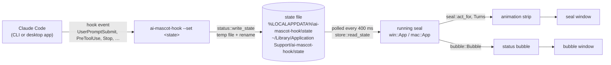
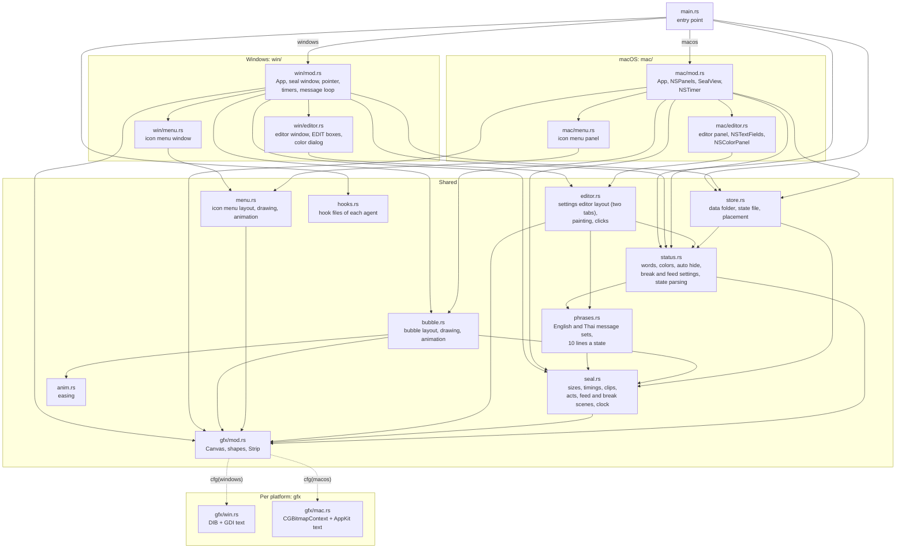
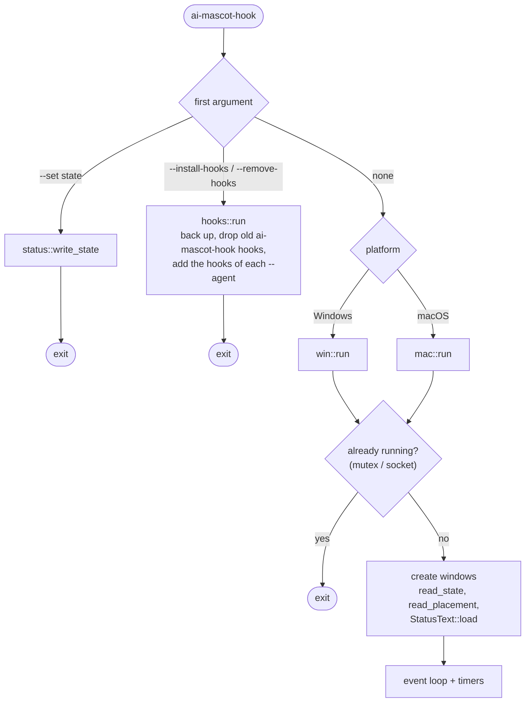
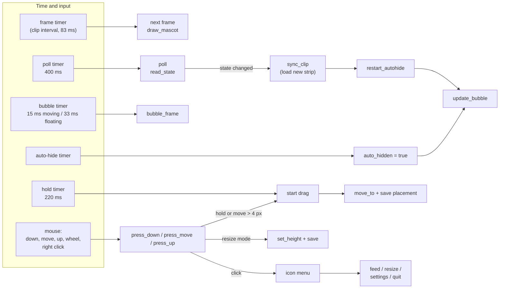
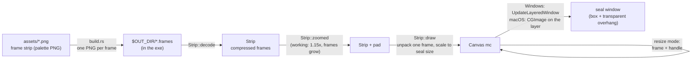
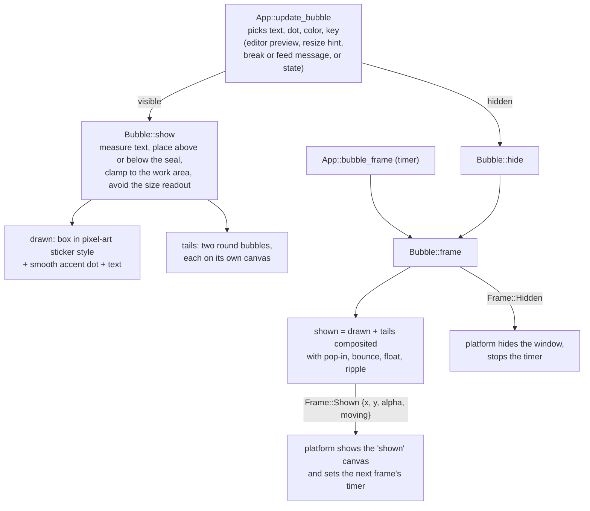
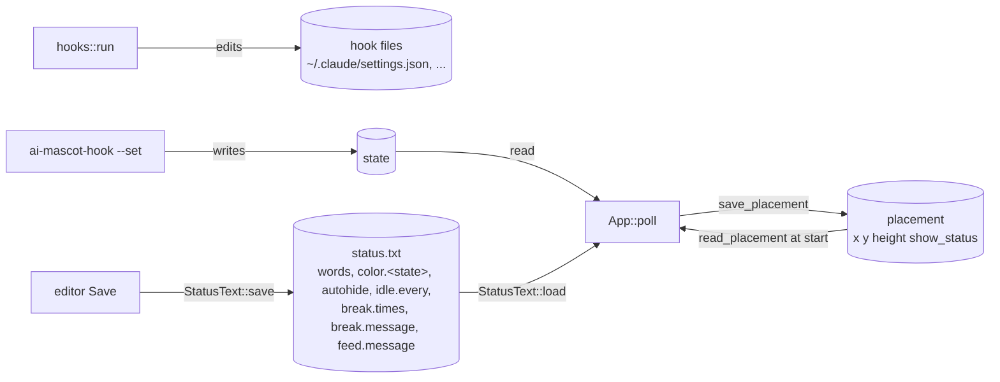

# How the code fits together

[ภาษาไทย](../th/architecture.md)

ai-mascot-hook is one Rust binary with two jobs:

- **The hook command.** `ai-mascot-hook --set <state>` writes one word to a file and exits at once.
- **The seal.** With no arguments, it opens the windows, watches that file, and plays the
  matching animation and bubble.

Most of the code is shared. Only the windowing layer is written separately for Windows
and for macOS.

## 1. From Claude Code to the screen

| Claude Code event | State | Animation |
|---|---|---|
| `SessionStart`, `SessionEnd` | `idle` | napping; every minute (`idle.every`) sliding, a toy car, a ball or waving |
| `UserPromptSubmit` | `loading` | clapping, then sitting and thinking |
| `PreToolUse`, `PostToolUse` | `working` | swimming in a hard hat |
| `PermissionRequest`, `Notification` | `asking` | waving on an ice floe |
| `Stop` | `completed` | showing off in sunglasses |
| `StopFailure` | `error` | crying |

A state's `Act` lists its clips (and, for idle, a `rest` clip it naps on for `REST_MS`
between them). `Turns` (in `seal.rs`) keeps which one is playing; each time the clip
comes back to its first frame, the platform asks `Turns::looped` whether another takes
over, and if so unpacks it. A `CutIn` plays over the act and then lets it go on: `FEED`
from the menu's Feed button, `BREAK` when the poll finds the clock at a break time
(`status.breaks`, checked with `seal::minute_of_day`); a click on the seal ends a break.

The Claude desktop app is a packaged (MSIX) app. Windows redirects the state file that its
hooks write into `%LOCALAPPDATA%\Packages\<app>\LocalCache\Local\ai-mascot-hook\state`.
`store::state_files` also finds those copies, and `store::read_state` follows whichever
file was written most recently.

## 2. Module map

- **Shared code** has no platform calls, apart from `gfx`, which picks its back end at
  compile time.
- **The `win` and `mac` apps** do the same things in the same order. They are written
  separately because each uses its platform's own windows, events and timers.

## 3. Starting up

## 4. The running seal

Both apps keep one `App` in a thread-local and reach it through `with(|app| ...)`.
Timers and pointer events call into it:

On Windows each source is a Win32 timer (`TIMER_FRAME`, `TIMER_POLL`, `TIMER_BUBBLE`,
`TIMER_AUTOHIDE`, `TIMER_HOLD`, plus `TIMER_MENU` for the menu animation). On macOS one
60 Hz `NSTimer` calls `App::tick`, which checks when each of these is due.

## 5. Drawing the seal

The seal's **box** (x, y, height) is what gets saved, dragged and resized, and what the
bubble is placed against. For the zoomed `working` clip, the **window** reaches past the
box (`overhang`). Pointer positions are mapped back into the box (`in_box`).

## 6. The status bubble

`bubble::Bubble` does everything except show the result:

Animation inputs: `appear` (0 to 1: pop in over 0.5 s, fade out over 0.18 s), `pop` (the
bounce when `key` changes), and a clock for the 2.8 s float and the dot's ripple. Easing
comes from `anim.rs`.

## 7. Files on disk

All of these files except `settings.json` live in the data folder (`store::data_dir`):
`%LOCALAPPDATA%\ai-mascot-hook` on Windows, `~/Library/Application Support/ai-mascot-hook` on macOS.

## Where to change things

| To change | Look in |
|---|---|
| Which event sets which state | `hooks.rs` (the `Plan` of each agent), `tools/install-hooks.ps1` |
| A state's animations, speed or size | `seal.rs` (`Clip`, `Act`, `act_for`) |
| The bubble's look or motion | `bubble.rs` |
| Default words and colors | `status.rs` (`STATES`, `DEFAULT_COLOR`, `DEFAULT_BREAK_MESSAGE`, `DEFAULT_FEED_MESSAGE`) |
| The English and Thai message sets | `phrases.rs` (`ENGLISH`, `THAI`, `SETS`) |
| The feed and break scenes, idle's nap length | `seal.rs` (`FEED`, `BREAK`, `REST_MS`, `TURN_MS`) |
| The icon menu's or the editor's look | `menu.rs` / `editor.rs` |
| Windows menu / editor windows | `win/menu.rs` / `win/editor.rs` |
| Mac windows and input | `mac/mod.rs`, `mac/menu.rs`, `mac/editor.rs` |
| Text rendering or putting pixels on screen | `gfx/win.rs`, `gfx/mac.rs` |
