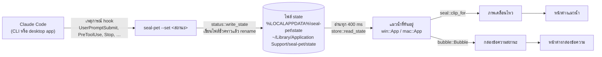
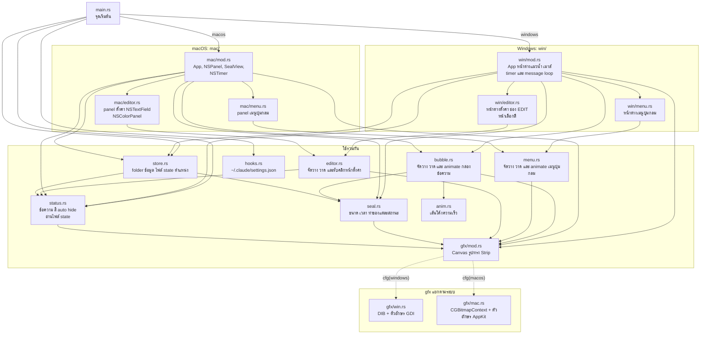
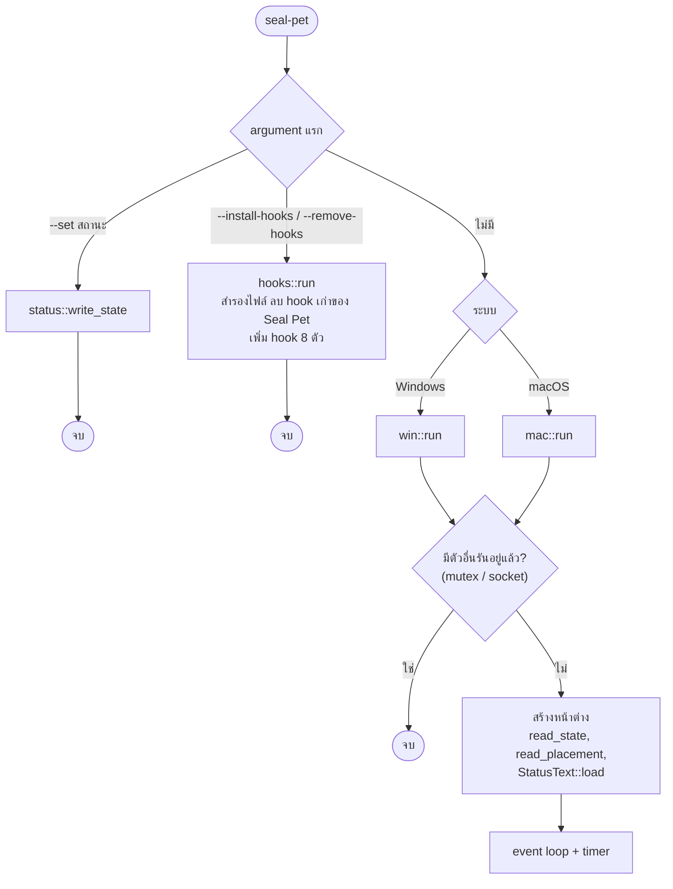
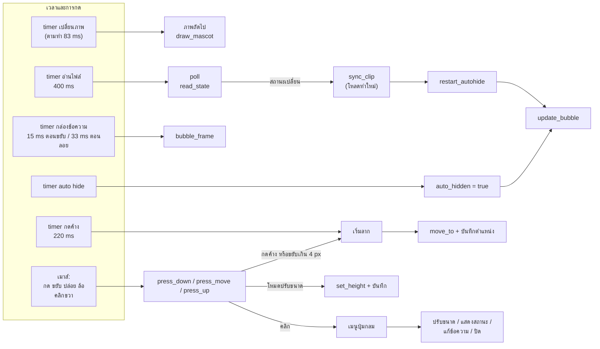
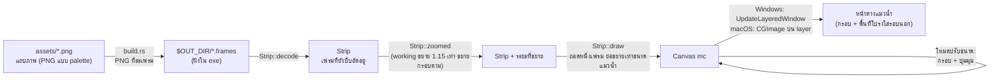
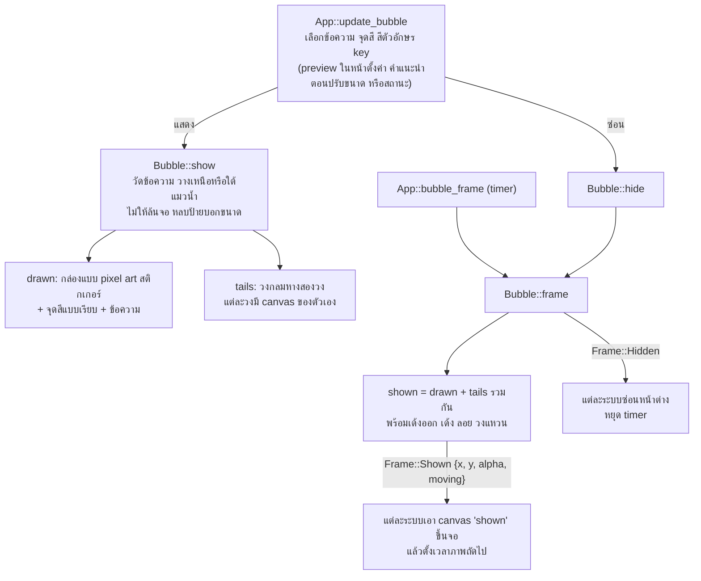
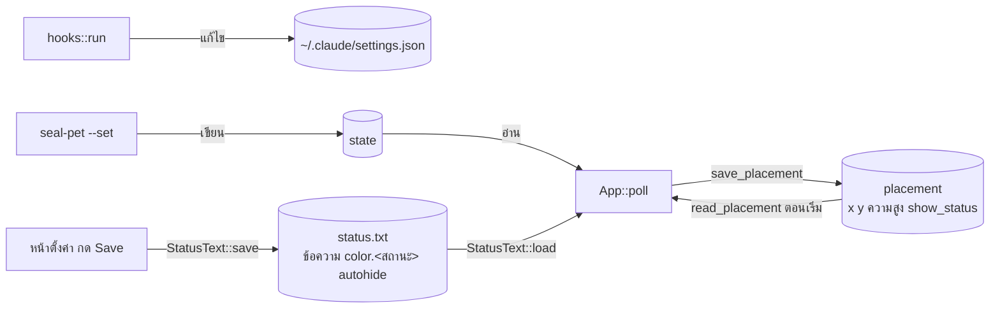

# โครงสร้างและการเชื่อมต่อของโค้ด

[English](../en/architecture.md)

Seal Pet เป็นโปรแกรม Rust ไฟล์เดียว ทำสองหน้าที่:

- **คำสั่งสำหรับ hook:** `seal-pet --set <สถานะ>` เขียนคำหนึ่งคำลงไฟล์แล้วจบทันที
- **ตัวแมวน้ำ:** ถ้ารันโดยไม่ใส่ argument จะเปิดหน้าต่าง คอยดูไฟล์นั้น แล้วเล่นท่าทางและแสดงกล่องข้อความตามสถานะ

โค้ดส่วนใหญ่ใช้ร่วมกันทั้งสองระบบ มีแค่ส่วนจัดการหน้าต่างที่เขียนแยกสำหรับ Windows และ macOS

## 1. จาก Claude Code ถึงหน้าจอ

| เหตุการณ์ของ Claude Code | สถานะ | ท่าทาง |
|---|---|---|
| `SessionStart`, `SessionEnd` | `idle` | นอนหลับ |
| `UserPromptSubmit` | `loading` | ตบมือ |
| `PreToolUse`, `PostToolUse` | `working` | ว่ายน้ำใส่หมวกนิรภัย |
| `PermissionRequest`, `Notification` | `asking` | โบกมือบนก้อนน้ำแข็ง |
| `Stop` | `completed` | นอนหลับ |

Claude desktop app เป็นแอปแบบ MSIX Windows จะย้ายไฟล์ state ที่ hook ของแอปนี้เขียน ไปไว้ที่
`%LOCALAPPDATA%\Packages\<แอป>\LocalCache\Local\seal-pet\state`
`store::state_files` หาไฟล์ที่ถูกย้ายพวกนี้ด้วย และ `store::read_state` จะใช้ไฟล์ที่เขียนล่าสุด

## 2. แผนผัง module

- **โค้ดที่ใช้ร่วมกัน** ไม่เรียกระบบปฏิบัติการตรงๆ ยกเว้น `gfx` ซึ่งเลือกส่วนของแต่ละระบบตอน compile
- **แอปฝั่ง `win` และ `mac`** ทำงานเหมือนกันและเรียงลำดับเดียวกัน ที่ต้องเขียนแยกเพราะแต่ละระบบใช้หน้าต่าง event และ timer ของตัวเอง

## 3. ตอนเริ่มโปรแกรม

## 4. ระหว่างแมวน้ำทำงาน

ทั้งสองแอปเก็บ `App` ไว้ตัวเดียวในตัวแปรของ thread และเข้าถึงผ่าน `with(|app| ...)`
timer และ event ของเมาส์จะเรียกเข้ามาที่ตัวนี้:

บน Windows แต่ละอย่างเป็น timer ของ Win32 (`TIMER_FRAME`, `TIMER_POLL`, `TIMER_BUBBLE`,
`TIMER_AUTOHIDE`, `TIMER_HOLD` และ `TIMER_MENU` สำหรับ animation ของเมนู)
บน macOS ใช้ `NSTimer` ตัวเดียวที่ 60 ครั้งต่อวินาที เรียก `App::tick` แล้วเช็คว่าถึงเวลาทำอะไรบ้าง

## 5. การวาดแมวน้ำ

**กรอบ** ของแมวน้ำ (x, y, ความสูง) คือส่วนที่ถูกบันทึก ถูกลาก ถูกปรับขนาด และใช้วาง bubble
สำหรับท่า `working` ที่ขยาย **หน้าต่าง** จะใหญ่เกินกรอบออกไป (`overhang`)
ตำแหน่งเมาส์จะถูกแปลงกลับมาเทียบกับกรอบเสมอ (`in_box`)

## 6. กล่องข้อความสถานะ

`bubble::Bubble` ทำทุกอย่าง ยกเว้นการเอาภาพขึ้นจอ:

ค่าที่ใช้คุม animation:

- `appear` (0 ถึง 1): เด้งออกภายใน 0.5 วินาที จางหายภายใน 0.18 วินาที
- `pop`: การเด้งตอน `key` เปลี่ยน
- นาฬิกา: ใช้กับการลอยรอบละ 2.8 วินาที และวงแหวนจากจุดสี

เส้นโค้งความเร็วมาจาก `anim.rs`

## 7. ไฟล์ที่เกี่ยวข้อง

ทุกไฟล์ยกเว้น `settings.json` อยู่ใน folder ข้อมูล (`store::data_dir`)
คือ `%LOCALAPPDATA%\seal-pet` บน Windows และ `~/Library/Application Support/seal-pet` บน macOS

## จะแก้อะไร ดูที่ไหน

| อยากแก้ | ดูที่ |
|---|---|
| เหตุการณ์ไหนตั้งสถานะอะไร | `hooks.rs` (`PLAN`), `tools/install-hooks.ps1` |
| ท่า ความเร็ว หรือขนาดของแต่ละสถานะ | `seal.rs` (`Clip`, `clip_for`) |
| หน้าตาหรือการเคลื่อนไหวของกล่องข้อความ | `bubble.rs` |
| ข้อความและสีเริ่มต้น | `status.rs` (`STATES`, `DEFAULT_COLOR`) |
| หน้าตาเมนูปุ่มกลม หรือหน้าตั้งค่า | `menu.rs` / `editor.rs` |
| หน้าต่างเมนู / หน้าตั้งค่าบน Windows | `win/menu.rs` / `win/editor.rs` |
| หน้าต่างและการกดบน Mac | `mac/mod.rs`, `mac/menu.rs`, `mac/editor.rs` |
| การวาดตัวอักษร หรือเอาภาพขึ้นจอ | `gfx/win.rs`, `gfx/mac.rs` |
